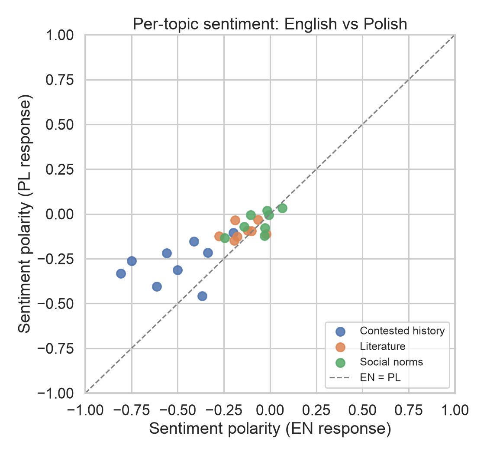
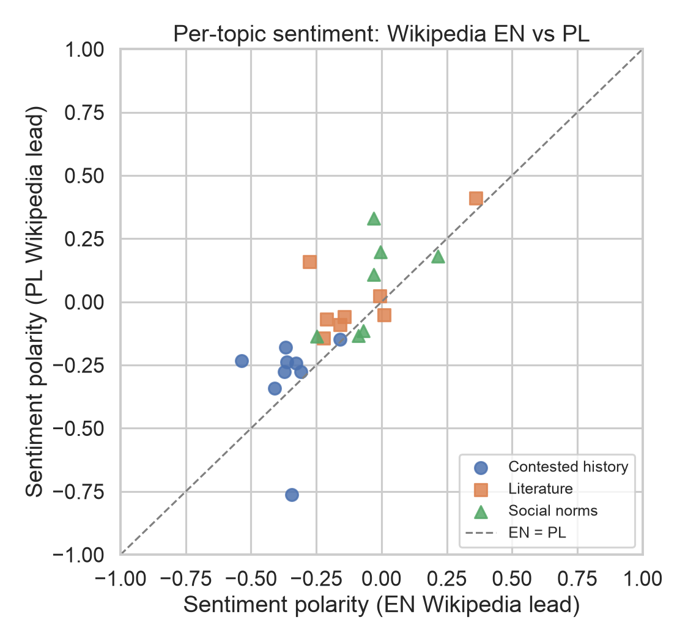
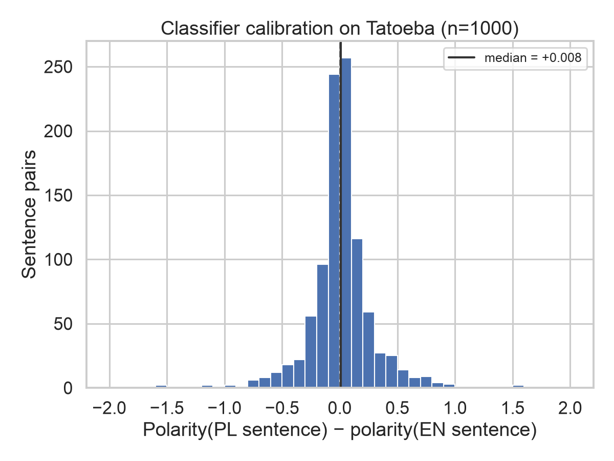
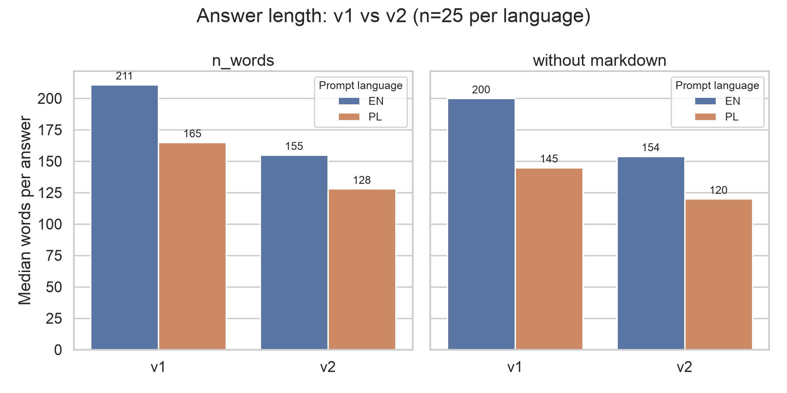

# Lost in Translation

**Does Claude answer the same question differently in English and in Polish?**
A small, fully reproducible study of 25 Polish cultural topics, asked in both languages,
with English and Polish Wikipedia as a human-written reference point.

> Short report: [docs/portfolio_report.md](docs/portfolio_report.md).
> The v1 numbers below are copied from `results/v1/stats/stats_summary.txt`.

## Research Question & Hypotheses

**Research question:** Does English-language dominance in LLM training data cause a model to reframe culturally significant Polish topics through an Anglophone lens, even when responding in Polish?

**Hypotheses**
- **H1 (Homogenization):** English and Polish answers to the same prompt will be semantically near-identical (high cross-lingual cosine similarity), consistent with both being generated from one shared underlying representation.
- **H2 (Anchoring / Native Pull):** Polish answers will be less anchored in Polish-language discourse (Polish Wikipedia) than English answers are in English-language discourse (native_pull(PL) < native_pull(EN)).
- **H3 (Affective Framing):** The sentiment of paired answers will diverge by prompt language, most strongly in the contested-history domain.

## Design

| | |
|---|---|
| Topics | 25 prompt pairs in 3 domains: contested history (9), literature (8), social norms (8) — `src/prompts.py` |
| Conditions | each prompt asked once in English and once in Polish (translated prompt pairs) |
| Model (v1) | `claude-sonnet-4-5` (alias), `temperature=0`, `max_tokens=600`, single user turn, no system prompt |
| Human baseline | lead section of the matching EN and PL Wikipedia article (24 topics; s06 has none) |
| Similarity | cosine on [LaBSE](https://huggingface.co/sentence-transformers/LaBSE) sentence embeddings |
| Sentiment | [cardiffnlp/twitter-xlm-roberta-base-sentiment](https://huggingface.co/cardiffnlp/twitter-xlm-roberta-base-sentiment); polarity = P(pos) − P(neg); input truncated at 512 tokens |
| Statistics | paired Wilcoxon signed-rank tests; medians; matched-pairs rank-biserial correlation as effect size |

Measures:

- **Homogenisation** — `cosine(EN answer, PL answer)` per topic.
- **Native pull** — `sim(answer, wiki in own language) − sim(answer, wiki in other language)`, computed for EN and PL answers and compared.
- **Sentiment gap** — polarity of the PL answer vs the EN answer.
- **Length** — words per answer (control).

## Results (v1, course submission)

| Measure | n | EN | PL | Test | p | rank-biserial |
|---|---|---|---|---|---|---|
| Cosine(EN answer, PL answer), median: all topics | 25 | 0.811 (mean 0.809, sd 0.034) | | | | |
| &nbsp;&nbsp;contested history | 9 | 0.820 | | | | |
| &nbsp;&nbsp;literature | 8 | 0.809 | | | | |
| &nbsp;&nbsp;social norms | 8 | 0.784 | | | | |
| Native pull, median | 24 | +0.091 | +0.067 | Wilcoxon W = 127.0 | 0.5271 | +0.153 (EN − PL) |
| Sentiment polarity, median | 25 | −0.190 | −0.100 | Wilcoxon W = 39.0 | 0.0004 | +0.760 (PL − EN) |
| &nbsp;&nbsp;contested history | 9 | −0.398 | −0.161 | | | median diff +0.198 |
| &nbsp;&nbsp;literature | 8 | −0.190 | −0.079 | | | median diff +0.106 |
| &nbsp;&nbsp;social norms | 8 | −0.063 | −0.082 | | | median diff −0.031 |
| Answer length, median words | 25 | 211 | 165 | | | |

Two v1 answers end mid-sentence: **l02-en** and **l08-pl**. v1 did not log `stop_reason`, so
whether the 600-token cap cut them is not recorded. They are kept in all analyses.

## Figures (v1)

| | |
|---|---|
|  |  |
|  |  |

Captions: [`results/v1/figures/captions.txt`](results/v1/figures/captions.txt).

## v2: length set in the prompt, pinned model, baselines

v2 repeats the collection with `claude-sonnet-4-5-20250929`, `temperature=0`, `max_tokens=2000`
and "Answer in about 150 words." / "Odpowiedz w około 150 słowach." added to each prompt
(all 50 answers `stop_reason=end_turn`). It also adds a Wikipedia sentiment baseline, a
chunk-and-average sensitivity check, a second word count without markdown, and a classifier
calibration check on 1000 Tatoeba EN–PL sentence pairs. Details: [CHANGELOG.md](CHANGELOG.md).

Full table (all tests, both runs, effect sizes): [`results/results_table.md`](results/results_table.md)
· word counts: [`results/word_counts.md`](results/word_counts.md)

| Test (paired Wilcoxon) | run | n | median A | median B | W | p | rank-biserial |
|---|---|---|---|---|---|---|---|
| Native pull: EN vs PL answers | v1 | 24 | +0.091 | +0.067 | 127.0 | 0.5271 | +0.153 |
| | v2 | 24 | +0.120 | +0.026 | 66.0 | 0.0150 | +0.560 |
| Answer sentiment: PL vs EN | v1 | 25 | −0.100 | −0.190 | 39.0 | 0.0004 | +0.760 |
| | v2 | 25 | −0.122 | −0.190 | 49.0 | 0.0015 | +0.698 |
| Wikipedia lead sentiment: PL vs EN | — | 24 | −0.123 | −0.185 | 46.0 | 0.0020 | +0.693 |
| Gap (PL−EN): answers vs Wikipedia | v1 | 24 | +0.106 | +0.081 | 125.0 | 0.4908 | +0.167 |
| | v2 | 24 | +0.062 | +0.081 | 132.0 | 0.6231 | +0.120 |
| Tatoeba calibration: PL vs EN sentence | — | 1000 | −0.102 | −0.109 | 228522.0 | 0.0174 | +0.087 |

Sentiment rows use the 512-token truncation (primary); chunk-and-average values are in the full table.

| | |
|---|---|
|  |  |
|  |  |

All v2 figures: `results/v2/figures/`.

## Interpretation of v2 Results (Exploratory Analyses)

*Note: Multiple tests were performed without correction for multiple comparisons, and v2 conditions were adjusted after observing v1. The v2 analyses are therefore treated as exploratory.*

**Wikipedia sentiment baseline and discourse adaptation.** Wikipedia's own lead sections show a significant language-based sentiment gap: Polish leads are less negative than English leads (p = .002, r = +.69). The PL−EN gap in the model's answers does not differ significantly from this baseline gap (p = .62). This is consistent with genuine adaptation rather than a pure artifact of an "English lens." If so, the model tracks register and framing differences present in native-language sources, where Polish framing of historical traumas appears less unilaterally negative than Anglophone accounts. Because Wikipedia is itself part of the training data, this may reflect adaptation to specific source texts rather than to Polish discourse in general. Given the small sample (n = 24) and the different genres of answers and Wikipedia leads, this should be interpreted cautiously.

**Tatoeba calibration check.** The calibration on Tatoeba sentence pairs reveals a minor classifier bias: the sentiment model rates Polish sentences slightly more positively than their English translations (median PL−EN difference = +.008, p = .017, r = +.09). This shift is roughly an order of magnitude smaller than the sentiment gap in model answers (overall +.07 in v2; up to +.20 for contested history in v1). Tatoeba consists of short everyday sentences rather than texts about historical events, so the check transfers only partly to this data. Calibration bias therefore exists but is unlikely to explain most of the gap; the affective divergence appears to be primarily a property of the model's generation.

**Native pull under v2 generation conditions (H2).** With answer length constrained through the prompt instruction, which may also have changed answer style, English answers anchor more strongly to English Wikipedia than Polish answers do to Polish Wikipedia (medians +.120 vs +.026; Wilcoxon W = 66.0, p = .015, r = +.56). Unlike the non-significant trend in v1 (p = .53), this supports H2 under v2 conditions. The v1–v2 difference suggests that native pull is sensitive to generation settings, rather than decisively confirming a fixed structural divergence.

## Conclusion

The answer to the research question is: partly. The tone difference between languages is consistent with the model following native-language sources rather than an English lens, while weaker native anchoring of Polish answers appears only under v2 conditions.

The central pattern holds in both runs: the model preserves semantic content across languages (homogenization median .81 in both v1 and v2) while differing in affective framing. Two qualifications apply:
1. The sentiment gap is consistent with patterns found in Wikipedia itself, which suggests the model reflects framing differences in its source texts rather than a simple translation flaw.
2. Support for the "English lens" hypothesis (H2) appears condition-dependent: the native anchoring measure is sensitive to generation prompts and length constraints.

## Repository layout

```
src/                  pipeline code (python -m src.run ...)
  prompts.py          the 25 EN/PL prompt pairs + Wikipedia titles
  collect.py          Claude answers  -> data/raw/<run>/llm_responses.csv
  wiki.py             Wikipedia text  -> data/raw/v1/wiki_articles.csv
  analyze.py          similarity, sentiment, Wilcoxon tests, figures
  config.py           runs (v1, ...), paths, model settings
  extended.py         clean word count, Wikipedia + chunked sentiment
  calibration.py      Tatoeba EN-PL classifier check
  tables.py           results table, word counts, fig5-fig7
  site_export.py      JSON for the website -> site/public/data/ (checked against the results table)
data/raw/v1/          collected data exactly as used for the course submission
data/raw/v2/          v2 prompts and answers
data/raw/calibration/ Tatoeba sample (with sentence ids)
data/processed/<run>/ per-topic metrics
results/v1/           stats_summary.txt + figures, as submitted
results/v2/           stats_summary.txt + figures for v2
results/              results_table, word_counts, baseline/, calibration/, comparison/
docs/                 portfolio report, paper (v1) and Wikipedia attribution
site/                 interactive website (Vite + TypeScript); text comes from docs/portfolio_report.md
.github/workflows/    builds the website and publishes it to GitHub Pages
```

Each run keeps its own `data/raw/<run>/`, `data/processed/<run>/` and `results/<run>/`;
a newer run never overwrites an older one.

## How to reproduce

```bash
python3.12 -m venv .venv && source .venv/bin/activate
pip install -r requirements.txt
cp .env.example .env        # fill in ANTHROPIC_API_KEY / WIKI_CONTACT if you want to collect

# Re-run the v1 analysis from the stored answers into a scratch folder
python -m src.run analyze --run v1 --out scratch/v1_repro
```

The first analysis run downloads LaBSE and XLM-R (~2 GB). The re-run reproduces
`results/v1/stats/stats_summary.txt` exactly and every per-topic metric to within 1e-6.
Strip-plot point positions in figures 1 and 3 differ slightly because the v1 jitter
was not seeded; the plotted values are identical.

Full v2 pipeline from the stored answers (writes into the repo; `analyze` refuses to
overwrite existing results without `--overwrite`):

```bash
python -m src.run analyze  --run v2
python -m src.run extended --run v1
python -m src.run extended --run v2
python -m src.run calibrate          # uses the committed Tatoeba sample if present
python -m src.run table
```

Collecting new answers (`collect`) needs an Anthropic API key and is resumable.
v1 answers cannot be collected again exactly: `temperature=0` is not guaranteed to be
deterministic, and the v1 model alias is retired on 2026-11-30.

Tested with Python 3.12 on macOS (Intel); see the comments in `requirements.txt`.

### Website

`site/` is an interactive version of the study. It reads only the exported JSON in
`site/public/data/` and the text of `docs/portfolio_report.md` (verbatim). Node.js 26:

```bash
python -m src.run site-data          # refresh site/public/data/*.json; stops if any row of results_table.csv differs
cd site && npm ci && npm run dev     # http://localhost:5173/lost_in_translation/
```

## Limitations

- 25 topics (24 with a Wikipedia baseline), one answer per prompt and language.
- `max_tokens=600` equalises tokens, not words: Polish answers are shorter in words (median 165 vs 211).
- The sentiment model was trained on tweets and reads at most 512 tokens of each text.
- The Wikipedia baseline is each article's lead section; EN leads are longer than PL leads (median 249 vs 117 words).
- v1 called the model alias `claude-sonnet-4-5` and did not log the model id returned by the API, the stop reason or token usage.

## Data and licences

- **Wikipedia text** (`data/raw/v1/wiki_articles.csv`, columns `summary` and `full_text`) comes from
  English and Polish Wikipedia and is licensed under
  [CC BY-SA 4.0](https://creativecommons.org/licenses/by-sa/4.0/). Article titles and URLs:
  [`docs/WIKIPEDIA_ATTRIBUTION.md`](docs/WIKIPEDIA_ATTRIBUTION.md).
- **Tatoeba sentences** (`data/raw/calibration/tatoeba_en_pl_sample.tsv`) come from
  [Tatoeba](https://tatoeba.org) and are licensed under
  [CC BY 2.0 FR](https://creativecommons.org/licenses/by/2.0/fr/); each row keeps its Tatoeba
  sentence ids (`eng_id`, `pol_id`) for attribution.
- **Model answers** (`llm_responses.csv`) were generated with Claude through the Anthropic API.
- **Code** is licensed under the [MIT licence](LICENSE).
- **Data** in `data/` is licensed under [CC BY-SA 4.0](https://creativecommons.org/licenses/by-sa/4.0/),
  because it includes Wikipedia text (see [`docs/WIKIPEDIA_ATTRIBUTION.md`](docs/WIKIPEDIA_ATTRIBUTION.md)).
  The Tatoeba sentences keep their own licence, CC BY 2.0 FR.

## AI assistance

In the preparation of this project, artificial intelligence tools (Claude, Anthropic) were used exclusively for technical support, including boilerplate code drafting, pipeline debugging, and formatting assistance.

## Version history

- `v1` — course submission (graded).
- `v2` — length in the prompt, pinned snapshot, baselines and calibration. See [CHANGELOG.md](CHANGELOG.md).
