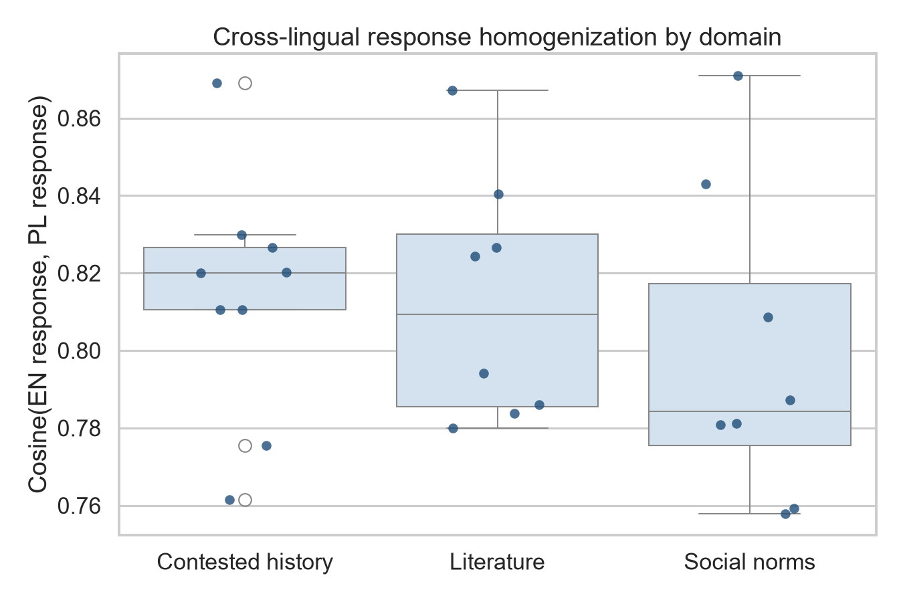
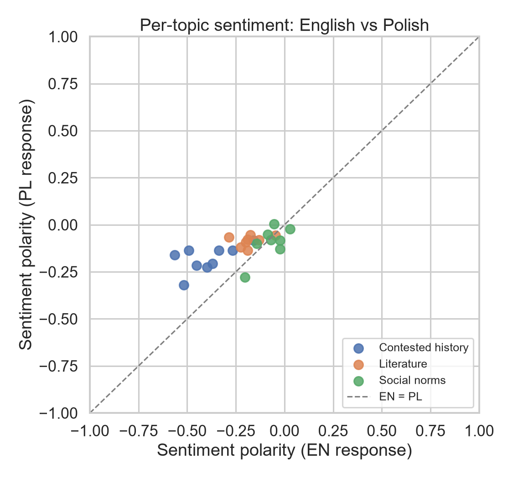
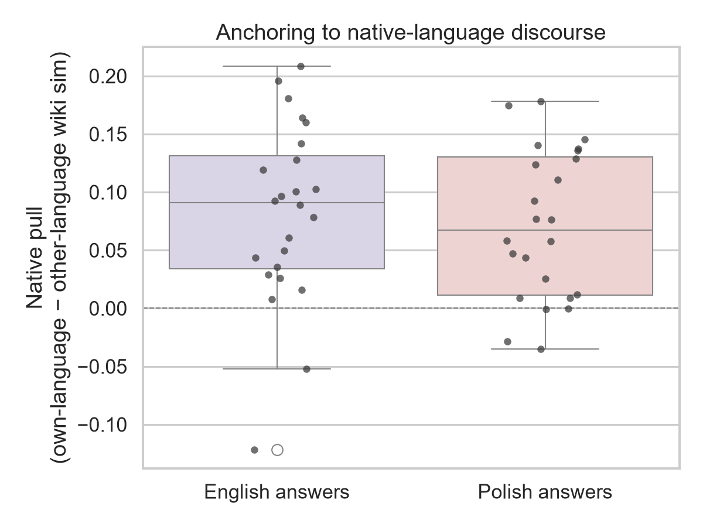
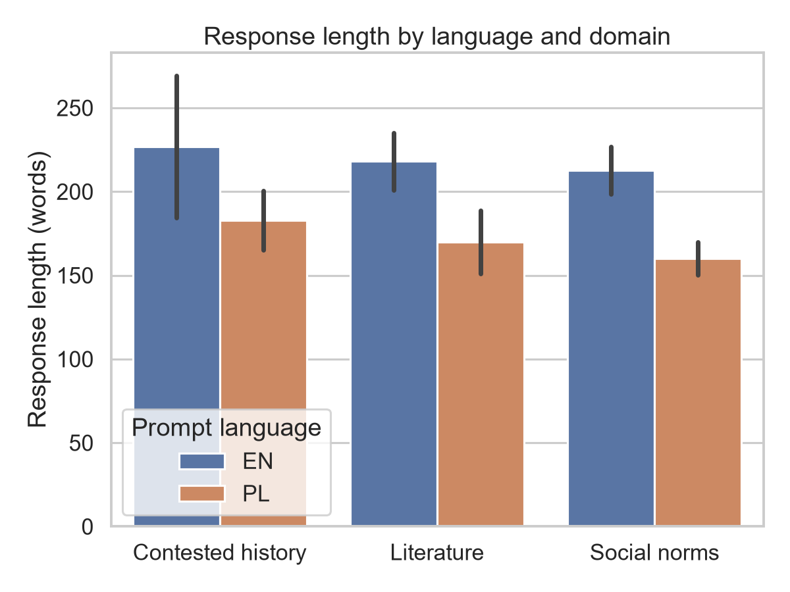

# Lost in Translation

**Does Claude answer the same question differently in English and in Polish?**
A small, fully reproducible study of 25 Polish cultural topics, asked in both languages,
with English and Polish Wikipedia as a human-written reference point.

> **Draft README.** Sections marked _TODO (author)_ are left for the author's own
> interpretation. The numbers below are copied from `results/v1/stats/stats_summary.txt`.

## Question

<!-- TODO (author): research question and hypotheses (H1–H3) in your own words. -->

## Design

| | |
|---|---|
| Topics | 25 prompt pairs in 3 domains: contested history (9), literature (8), social norms (8) — `src/prompts.py` |
| Conditions | each prompt asked once in English and once in Polish (translated prompt pairs) |
| Model (v1) | `claude-sonnet-4-5` (alias), `temperature=0`, `max_tokens=600`, single user turn, no system prompt |
| Human baseline | lead section of the matching EN and PL Wikipedia article (24 topics; s06 has none) |
| Similarity | cosine on [LaBSE](https://huggingface.co/sentence-transformers/LaBSE) sentence embeddings |
| Sentiment | [cardiffnlp/twitter-xlm-roberta-base-sentiment](https://huggingface.co/cardiffnlp/twitter-xlm-roberta-base-sentiment); polarity = P(pos) − P(neg); input truncated at 512 tokens |
| Statistics | paired Wilcoxon signed-rank tests; medians; matched-pairs rank-biserial correlation as effect size |

Measures:

- **Homogenisation** — `cosine(EN answer, PL answer)` per topic.
- **Native pull** — `sim(answer, wiki in own language) − sim(answer, wiki in other language)`, computed for EN and PL answers and compared.
- **Sentiment gap** — polarity of the PL answer vs the EN answer.
- **Length** — words per answer (control).

## Results (v1, course submission)

| Measure | n | EN | PL | Test | p | rank-biserial |
|---|---|---|---|---|---|---|
| Cosine(EN answer, PL answer), median: all topics | 25 | 0.811 (mean 0.809, sd 0.034) | | | | |
| &nbsp;&nbsp;contested history | 9 | 0.820 | | | | |
| &nbsp;&nbsp;literature | 8 | 0.809 | | | | |
| &nbsp;&nbsp;social norms | 8 | 0.784 | | | | |
| Native pull, median | 24 | +0.091 | +0.067 | Wilcoxon W = 127.0 | 0.5271 | +0.153 (EN − PL) |
| Sentiment polarity, median | 25 | −0.190 | −0.100 | Wilcoxon W = 39.0 | 0.0004 | +0.760 (PL − EN) |
| &nbsp;&nbsp;contested history | 9 | −0.398 | −0.161 | | | median diff +0.198 |
| &nbsp;&nbsp;literature | 8 | −0.190 | −0.079 | | | median diff +0.106 |
| &nbsp;&nbsp;social norms | 8 | −0.063 | −0.082 | | | median diff −0.031 |
| Answer length, median words | 25 | 211 | 165 | | | |

Two v1 answers end mid-sentence: **l02-en** and **l08-pl**. v1 did not log `stop_reason`, so
whether the 600-token cap cut them is not recorded. They are kept in all analyses.

<!-- TODO (author): interpretation. -->

## Figures (v1)

| | |
|---|---|
|  |  |
|  |  |

Captions: [`results/v1/figures/captions.txt`](results/v1/figures/captions.txt).

## Repository layout

```
src/                  pipeline code (python -m src.run ...)
  prompts.py          the 25 EN/PL prompt pairs + Wikipedia titles
  collect.py          Claude answers  -> data/raw/<run>/llm_responses.csv
  wiki.py             Wikipedia text  -> data/raw/v1/wiki_articles.csv
  analyze.py          similarity, sentiment, Wilcoxon tests, figures
  config.py           runs (v1, ...), paths, model settings
data/raw/v1/          collected data exactly as used for the course submission
data/processed/v1/    per-topic metrics (analysis_per_prompt.csv)
results/v1/           stats_summary.txt + figures, as submitted
docs/                 paper (v1) and Wikipedia attribution
```

Each run keeps its own `data/raw/<run>/`, `data/processed/<run>/` and `results/<run>/`;
a newer run never overwrites an older one.

## How to reproduce

```bash
python3.12 -m venv .venv && source .venv/bin/activate
pip install -r requirements.txt
cp .env.example .env        # fill in ANTHROPIC_API_KEY / WIKI_CONTACT if you want to collect

# Re-run the v1 analysis from the stored answers into a scratch folder
python -m src.run analyze --run v1 --out scratch/v1_repro
```

The first analysis run downloads LaBSE and XLM-R (~2 GB). The re-run reproduces
`results/v1/stats/stats_summary.txt` exactly and every per-topic metric to within 1e-6.
Strip-plot point positions in figures 1 and 3 differ slightly because the v1 jitter
was not seeded; the plotted values are identical.

Collecting new answers (`collect`) needs an Anthropic API key and is resumable.
v1 answers cannot be collected again exactly: `temperature=0` is not guaranteed to be
deterministic, and the v1 model alias is retired on 2026-11-30.

Tested with Python 3.12 on macOS (Intel); see the comments in `requirements.txt`.

## Limitations

<!-- TODO (author): edit / extend. Factual points from the code and data: -->

- 25 topics (24 with a Wikipedia baseline), one answer per prompt and language.
- `max_tokens=600` equalises tokens, not words: Polish answers are shorter in words (median 165 vs 211).
- The sentiment model was trained on tweets and reads at most 512 tokens of each text.
- The Wikipedia baseline is each article's lead section; EN leads are longer than PL leads (median 249 vs 117 words).
- v1 called the model alias `claude-sonnet-4-5` and did not log the model id returned by the API, the stop reason or token usage.

## Data and licences

- **Wikipedia text** (`data/raw/v1/wiki_articles.csv`, columns `summary` and `full_text`) comes from
  English and Polish Wikipedia and is licensed under
  [CC BY-SA 4.0](https://creativecommons.org/licenses/by-sa/4.0/). Article titles and URLs:
  [`docs/WIKIPEDIA_ATTRIBUTION.md`](docs/WIKIPEDIA_ATTRIBUTION.md).
- **Model answers** (`llm_responses.csv`) were generated with Claude through the Anthropic API.
- **Code**: <!-- TODO (author): choose a licence (e.g. MIT) and add LICENSE. -->

## Version history

- `v1` — course submission (graded). See [CHANGELOG.md](CHANGELOG.md).
