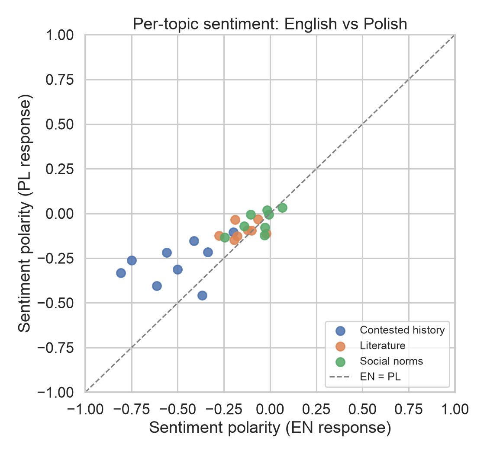
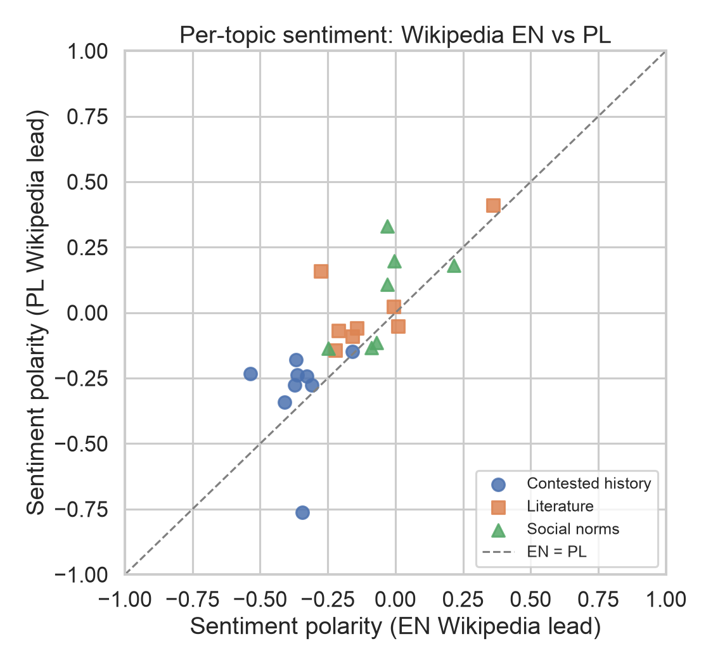
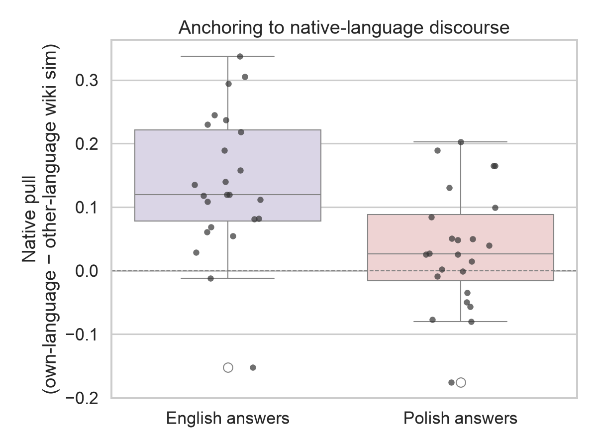

# Lost in Translation: Measuring English-Lens Bias in a Multilingual LLM's Answers About Polish Culture

**Katarzyna Frąckowiak** · Course project (Adam Mickiewicz University, Language, Mind & Technology), extended with a second run · November 2026
Repository: https://github.com/Kasia420/lost_in_translation

---

## 1. Abstract

Large language models are trained mostly on English text, so their answers about other cultures may be filtered through an English lens even when the question is asked in the native language. I tested this on one model (Claude Sonnet 4.5) with 25 translation-matched prompts about Polish history, literature and customs, asked in English and in Polish, in two runs (v2 pins the model snapshot and asks for about 150 words). English and Polish answers were similar in content (median cosine similarity .81 in both runs), but Polish answers were less negative (p = .0004 in v1, p = .0015 in v2), mainly on contested history. Wikipedia lead sections show a gap in the same direction, and a check on 1,000 translation pairs found only a small classifier shift. Anchoring to same-language Wikipedia favoured English only in v2 (p = .015; exploratory). The English-lens hypothesis is therefore only partly supported.

## 2. Question and design

**Research question.** Does English-language dominance in LLM training data lead a model to reframe culturally significant Polish topics through an English lens, even when it answers in Polish?

**Hypotheses.**
- **H1 (homogenization):** English and Polish answers to the same prompt are semantically near-identical.
- **H2 (anchoring):** Polish answers are less anchored in Polish Wikipedia than English answers are in English Wikipedia (native pull PL < EN).
- **H3 (affective framing):** the sentiment of paired answers differs by prompt language, most strongly for contested history.

**Design.** A within-topic paired design: 25 topics in three domains (contested history 9, literature 8, social norms 8), each asked as a translation-matched prompt pair in English and Polish, with one answer per prompt and language (temperature 0, single user turn, no system prompt). The lead sections of the matching English and Polish Wikipedia articles serve as a human-written baseline (24 topics; topic s06 has no article).

| | v1 (course submission) | v2 (re-run) |
|---|---|---|
| Date | June 2026 | 6 November 2026 |
| Model | alias `claude-sonnet-4-5` | snapshot `claude-sonnet-4-5-20250929` |
| Length control | `max_tokens = 600` | "Answer in about 150 words" in the prompt, `max_tokens = 2000` |
| Added checks | — | Wikipedia sentiment baseline; classifier calibration on 1,000 Tatoeba EN–PL pairs |

**Measures.** Cosine similarity of LaBSE embeddings: *homogenization* is the cosine between the EN and PL answer; *native pull* is an answer's similarity to the same-language Wikipedia lead minus its similarity to the other-language lead. *Sentiment polarity* is P(positive) − P(negative) from the XLM-R classifier `cardiffnlp/twitter-xlm-roberta-base-sentiment`, truncated at 512 tokens. Comparisons use paired two-sided Wilcoxon signed-rank tests, with the matched-pairs rank-biserial correlation *r* as effect size.

## 3. Results

**Table 1.** Paired comparisons (Wilcoxon signed-rank, two-sided; *r* = rank-biserial correlation of A − B).

| Measure | Run | n | Median A | Median B | p | r |
|---|---|---|---|---|---|---|
| Cosine (EN answer, PL answer) | v1 | 25 | .811 | — | — | — |
| | v2 | 25 | .810 | — | — | — |
| Answer sentiment, PL (A) vs EN (B) | v1 | 25 | −.100 | −.190 | .0004 | +.76 |
| | v2 | 25 | −.122 | −.190 | .0015 | +.70 |
| Native pull, EN (A) vs PL (B) answers | v1 | 24 | +.091 | +.067 | .53 | +.15 |
| | v2 | 24 | +.120 | +.026 | .015 | +.56 |
| Wikipedia lead sentiment, PL (A) vs EN (B) | — | 24 | −.123 | −.185 | .002 | +.69 |
| PL−EN gap: answers (A) vs Wikipedia (B) | v1 | 24 | +.106 | +.081 | .49 | +.17 |
| | v2 | 24 | +.062 | +.081 | .62 | +.12 |
| Tatoeba calibration, PL (A) vs EN (B) | — | 1,000 | −.102 | −.109 | .017 | +.09 |

*Notes.* Chunk-and-average sentiment gives the same results for the answers (p = .0004 in v1, p = .0015 in v2) and practically the same for Wikipedia (p = .0014). The v2 tests are exploratory and not corrected for multiple comparisons.

### 3.1 Cross-lingual similarity

English and Polish answers to the same prompt stayed semantically close: the median cosine similarity was .810 in v2 (mean .805, SD .049), essentially unchanged from v1 (.811). The ordering of domains reversed between runs. In v1, similarity was highest in contested history (.820) and lowest in social norms (.784); in v2 it was highest in social norms (.832) and lowest in contested history (.794), with literature in the middle both times (.809 and .808). With 8–9 topics per domain, I do not read this reversal as a stable domain effect.

### 3.2 Sentiment of the answers

Polish answers were less negative than English answers in both runs (Table 1, Figure 1). In v2 the median polarity was −.122 (PL) vs −.190 (EN), p = .0015, r = +.70; the median paired PL − EN difference was +.070 (n = 25). The gap is concentrated in contested history (median PL − EN difference +.208 in v2, +.198 in v1) and is small in literature (+.040) and social norms (+.019).



*Figure 1.* Sentiment polarity of each topic's English and Polish answer (v2, n = 25). Points above the dashed EN = PL line are more positive in Polish. The gap is largest in contested history.

### 3.3 Reference points: Wikipedia and classifier calibration

The Wikipedia lead sections show the same direction: Polish leads are less negative than English ones (−.123 vs −.185, p = .002, r = +.69; Figure 2). For the 24 topics with a Wikipedia baseline, the PL − EN gap in the answers did not differ detectably from the gap in Wikipedia (v2: +.062 vs +.081, p = .62; v1: p = .49). With n = 24, this is absence of evidence for a difference, not evidence of equivalence.

On 1,000 Tatoeba translation pairs, the classifier's PL − EN shift was small (median +.008, r = +.09): statistically detectable (p = .017), but much smaller than the shift in the answers (+.070). Both sentences of a pair received the same top label in 811 of 1,000 cases.



*Figure 2.* Sentiment polarity of the English vs Polish Wikipedia lead for each topic (n = 24). Polish leads are less negative (p = .002, r = +.69).

### 3.4 Anchoring in native-language discourse

In v2, English answers were more strongly anchored in English Wikipedia than Polish answers in Polish Wikipedia (median native pull +.120 vs +.026, p = .015, r = +.56; Figure 3). In v1 the direction was the same, but the difference was not significant (+.091 vs +.067, p = .53). The v2 change comes from both sides: English pull rose and Polish pull fell. Polish answers also remained shorter than English ones despite the length instruction (median 128 vs 155 words; v1: 165 vs 211).



*Figure 3.* Native pull: similarity of an answer to the Wikipedia lead in its own language minus similarity to the lead in the other language (v2, n = 24). Medians: EN +.120, PL +.026 (p = .015, r = +.56; exploratory).

## 4. Interpretation

**Wikipedia as a reference point.** The v1 report named the sentiment of the Wikipedia baselines as the decisive next step, and v2 supplies it. Polish Wikipedia leads are less negative than English ones, and the PL − EN gap in the answers does not differ detectably from the gap in Wikipedia. The direction of the answer gap is therefore already present in human-written text, which weakens the reading that it is a bias of the model. The domain pattern differs, though: the Wikipedia gap is similar across domains (+.083 contested history, +.074 literature, +.111 social norms), while in the v2 answers it is concentrated in contested history (+.208 vs +.040 and +.019). This is descriptive only (7–9 topics per domain), but it suggests the answers do not simply mirror Wikipedia.

**Classifier calibration.** On translation pairs the classifier shifted polarity only slightly, far less than the gap in the answers. An instrumental artefact therefore explains little of the effect, although short everyday sentences are not a perfect stand-in for long answers about history.

**Native pull.** The anchoring difference appeared in v2 but not in v1. It emerged only after the prompt and model settings changed, the test is exploratory and uncorrected, and LaBSE, which is trained to bring translations together, may compress language differences. I treat it as suggestive, not as confirmation of H2.

**Conclusion.** The English-lens hypothesis is partly supported. Polish answers are milder in tone, but a similar gap exists in Wikipedia, so the data cannot separate model bias from a reflection of the sources.

## 5. Limitations

The study covers one model and one language pair, so generalization is untested. Each prompt has a single answer per language, a point estimate rather than a distribution, and temperature 0 does not guarantee identical output on a re-run. The sentiment classifier was trained on tweets and reads at most 512 tokens, so polarity is a coarse signal, and the Tatoeba check covers short sentences rather than encyclopedic prose. The v2 tests are exploratory and not corrected for multiple comparisons. Wikipedia leads are an imperfect proxy for native discourse, and English leads are longer than Polish ones. Finally, the 150-word instruction only partly equalised length (median 155 vs 128 words), and two v1 answers end mid-sentence.

## 6. Reproducibility

Code, data and results are in the repository: https://github.com/Kasia420/lost_in_translation. Each run keeps its own folders, so v2 never overwrites v1. The v1 analysis was re-run from the stored answers and reproduces the submitted statistics exactly (per-topic metrics within 1e-6).

**v2 settings.** `claude-sonnet-4-5-20250929` (returned by the API for all 50 answers), temperature 0, `max_tokens = 2000`, a single user turn, and the length instruction appended to each prompt. All 50 answers were collected on 6 November 2026 with no retries, and all ended with `end_turn`. API version 2023-06-01, `anthropic` SDK 0.125.0, Python 3.12.

**Commands.** Analysing the stored answers needs no API key:

```
python -m src.run analyze  --run v2
python -m src.run extended --run v1
python -m src.run extended --run v2
python -m src.run calibrate
python -m src.run table
```

New answers can be collected with `python -m src.run collect --run v2` (requires `ANTHROPIC_API_KEY`). The `all` command alone is not enough, because it stops after `analyze` and does not run `extended`, `calibrate` or `table`. v1 answers cannot be regenerated exactly: temperature 0 is not guaranteed to be deterministic, and the v1 model alias retires on 30 November 2026. The Wikipedia baseline and the Tatoeba sample are stored in the repository.
